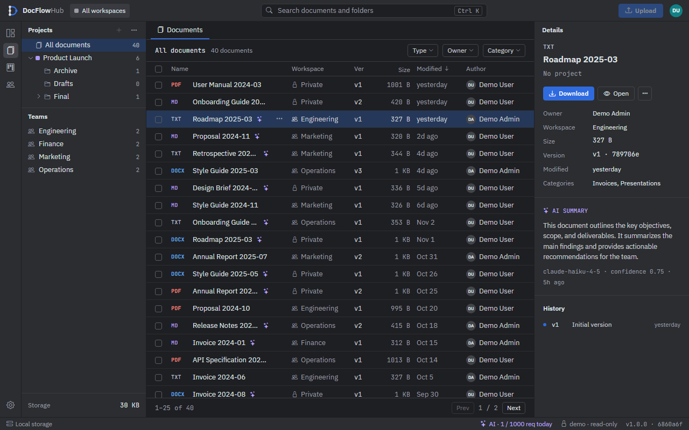
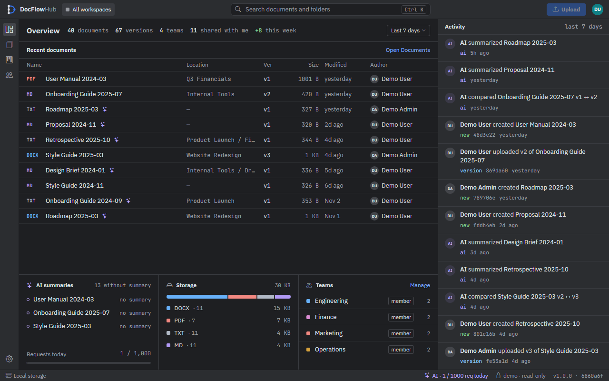
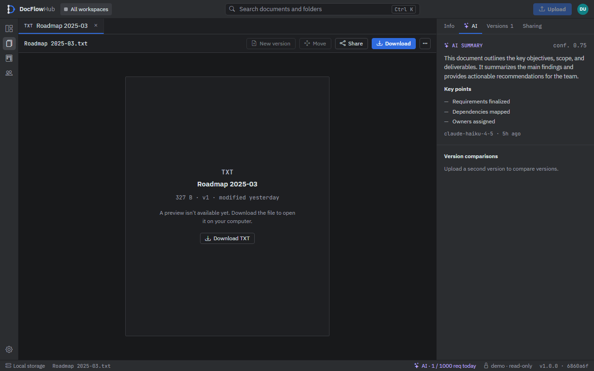
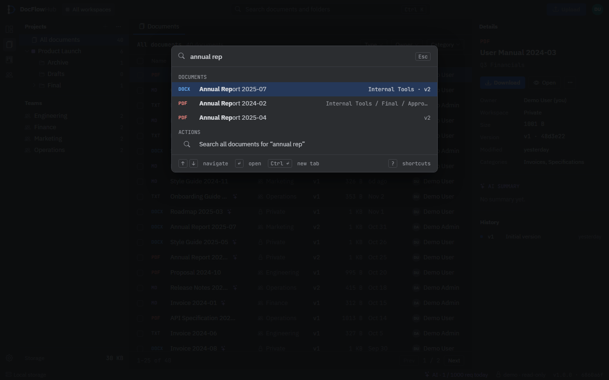
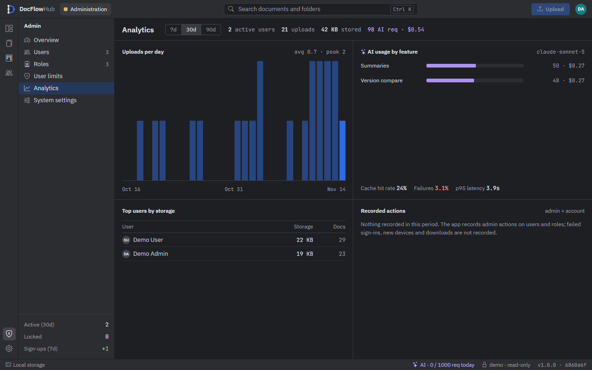
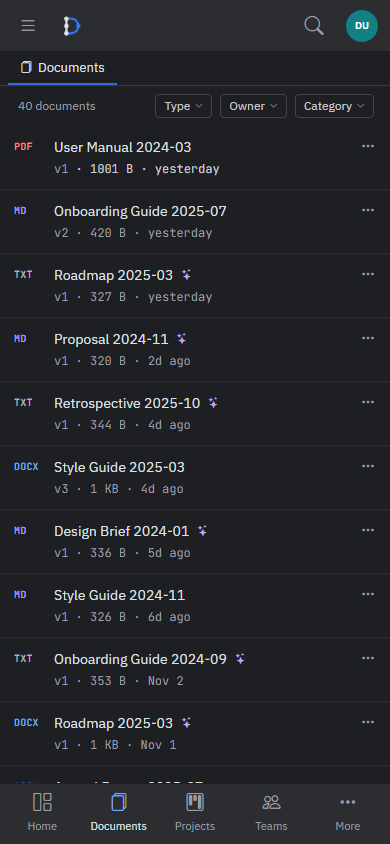

# DocFlowHub

**Document management with versions, teams and AI summaries — an ASP.NET Core portfolio project.**

[](https://github.com/bartoszclapinski/Doc-Flow-Hub/actions)
[](https://dotnet.microsoft.com/)

**Live demo:** [docflowhub-demo.onrender.com](https://docflowhub-demo.onrender.com) — read-only. Sign in as
`demo@docflowhub.com` or `demo-admin@docflowhub.com`, password `Demo123!`. The free server sleeps when
idle, so the first visit can take a minute.



## What it does

**Documents**
- Upload files (PDF, Word, text, Markdown, images) with a title, description and categories.
- Upload a new version of a document; older versions stay and can be downloaded or deleted.
- Projects with nested folders; drag a folder onto another to move it.
- Documents list with a project tree, filters (type, owner, category), sorting, paging, bulk move and
  bulk delete with a per-document result.

**Teams**
- Teams with Owner, Admin and Member roles. Share a document with a team and every member can open it,
  edit its details and upload new versions; only the owner can move, unshare or delete it.

**AI**
- A summary with key points for a document, and a comparison of two versions, from OpenAI or Anthropic
  models (each user picks a default model).
- Every AI request is logged (model, tokens, estimated cost, time). Each user has fixed limits of 1,000
  requests a day and 100 an hour.

**Administration**
- Users: search, status and role filters, bulk lock / unlock / assign role / delete, with your own
  account protected.
- Roles, AI usage per user today, analytics for 7 / 30 / 90 days (sign-ups, uploads, AI requests,
  storage per user, recorded actions).

**Interface**
- A dense, IDE-like dark interface: title bar, icon rail, tool windows, editor tabs, inspector, status bar.
- Command palette (`Ctrl K`) for documents, folders and actions; keyboard shortcuts (`?` lists them);
  a right-click menu on document rows.
- Responsive: the inspector becomes an overlay below 1024 px, the tree a drawer below 768 px, and phones
  get a bottom navigation bar and a two-line document list.

| | |
|---|---|
|  |  |
|  |  |



## Not there yet

Being clear about the gaps:
- **System settings** (admin) and most **AI preferences** are saved but not read by the app yet; the pages
  say so. The AI limits are fixed in code.
- **No e-mail and no inbox**: e-mails are only written to the log, and messages an administrator sends
  are saved but users have nowhere to read them.
- **No file preview** (the page offers a download) and **no line-by-line diff**; version comparison is the
  AI's description of the changes.
- No invitations, notifications, comments or real-time updates.

## Tech stack

- ASP.NET Core 10 Razor Pages, ASP.NET Core Identity
- Entity Framework Core 10 with SQL Server, or SQLite (used by the demo)
- File storage in Azure Blob Storage or a local folder
- OpenAI and Anthropic SDKs for the AI features
- Bootstrap 5 restyled with design tokens, plain JavaScript (no front-end framework), self-hosted
  IBM Plex Sans and JetBrains Mono
- xUnit unit tests (in-memory and SQLite), Playwright end-to-end tests
- Docker image and GitHub Actions CI (build, tests, container smoke test)

```
src/
  DocFlowHub.Core/            entities, DTOs, service interfaces
  DocFlowHub.Infrastructure/  EF Core, migrations, storage, AI and other services
  DocFlowHub.Web/             Razor Pages, view components, wwwroot (css/dfh, js/dfh)
tests/
  DocFlowHub.Tests/           xUnit
  e2e/                        Playwright
```

## Running it locally

Requirements: .NET 10 SDK and SQL Server LocalDB (or use SQLite, below). AI keys are optional.

```bash
git clone https://github.com/bartoszclapinski/Doc-Flow-Hub.git
cd Doc-Flow-Hub
dotnet run --project src/DocFlowHub.Web
```

The database is migrated on start and a default administrator, `admin@docflowhub.com`, is created
(the initial password is in `DbInitializer.cs`; change it). Settings go in
`src/DocFlowHub.Web/appsettings.Development.json` (git-ignored) or environment variables:

```json
{
  "ConnectionStrings": {
    "DefaultConnection": "Server=(localdb)\\mssqllocaldb;Database=DocFlowHub;Trusted_Connection=True;MultipleActiveResultSets=true"
  },
  "DocumentStorage": {
    "ConnectionString": "DefaultEndpointsProtocol=https;AccountName=...;AccountKey=...;EndpointSuffix=core.windows.net",
    "ContainerName": "documents"
  },
  "OpenAI": { "ApiKey": "..." },
  "Anthropic": { "ApiKey": "..." }
}
```

- Without Azure: `"DocumentStorage": { "Provider": "Local", "LocalPath": "C:/temp/docflowhub-files" }`.
- Without SQL Server: `"Database": { "Provider": "Sqlite" }` and
  `"ConnectionStrings": { "DefaultConnection": "Data Source=docflowhub.db" }`.
- The demo with sample data: `"DemoMode": { "Enabled": true }` (seeds the data and makes the app read-only).

## Tests

```bash
dotnet test tests/DocFlowHub.Tests --filter "Category!=LiveStorage"

cd tests/e2e
npm ci && npx playwright install chromium
BASE_URL=http://localhost:5118 npx playwright test smoke.spec.ts
```

`smoke.spec.ts` runs against the demo (CI runs it in the Docker image). The `*-actions.spec.ts` files
change data and skip themselves on the demo: run them against an instance seeded with demo data and
started with `DemoMode:Enabled=false`.

## Deployment

The public demo is one Docker container on Render (SQLite and local files, seeded on start), deployed
from `master` after CI passes. See [docs/demo-deployment.md](docs/demo-deployment.md).

## License

MIT.
